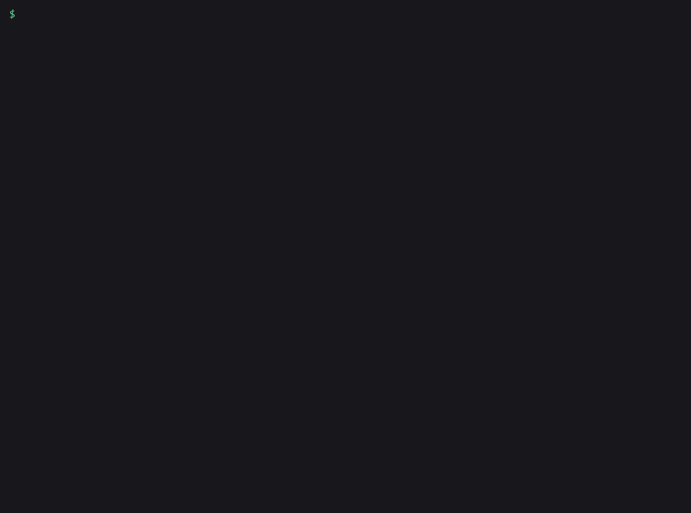
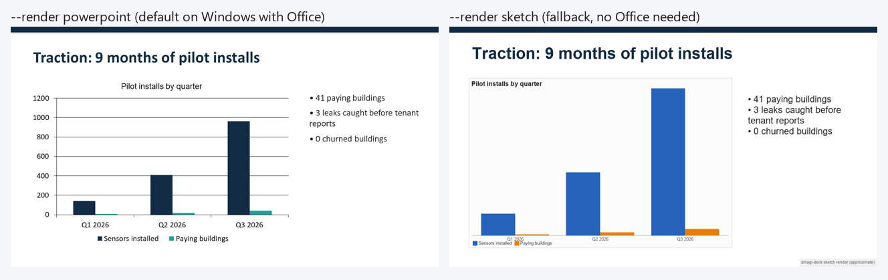

# amagi-deck

Let Claude look at your slides and read the numbers behind your charts. amagi-deck turns a
.pptx, .key, .ppt, .odp or slide PDF into one markdown file. Every slide gets a PNG render, its
text, its speaker notes, its tables, and each chart's data as a table. Use it to get feedback on
a pitch deck, pull figures out of a board deck, or turn a webinar deck into a blog post.



Text converters give a model the words on each slide. amagi-deck also gives it a picture of the
slide, so it can comment on layout and design, and the chart values, so it doesn't have to guess
them from bar heights. It runs on your machine. Nothing is uploaded, and you don't need an
account or an API key.



## Install

```
pipx install amagi-deck
```

Needs Python 3.9 or newer. For faithful slide images you also need Microsoft PowerPoint (Windows)
or [LibreOffice](https://www.libreoffice.org) (any OS). Without either one, amagi-deck still
writes all the text and data and draws a rough sketch of each slide (see
[Renderers](#renderers)).

## Usage

The [examples](examples) folder holds a made-up 9-slide seed deck for a leak-sensor startup,
with one hidden slide. This run was on Windows with PowerPoint installed:

```
$ amagi-deck pitch-deck.pptx -o review/pitch-deck.md
amagi-deck: wrote review\pitch-deck.md (9 slides, 9 images via powerpoint, 2 charts, 2 tables, 6 with notes)
```

It wrote `review/pitch-deck.md` and `review/pitch-deck_slides/slide-01.png` through
`slide-09.png`. The run took about 7 seconds. Here is slide 4 of the markdown:

```markdown
## Slide 4: Traction: 9 months of pilot installs


- 41 paying buildings
- 3 leaks caught before tenant reports
- 0 churned buildings

**Chart: Pilot installs by quarter** (column (clustered))

| Category | Sensors installed | Paying buildings |
|---|---|---|
| Q1 2026 | 140 | 6 |
| Q2 2026 | 410 | 19 |
| Q3 2026 | 960 | 41 |

**Speaker notes**

> Q3 is through September 30 only.
> The 3 caught leaks are the strongest proof point: tell the Elm Street story.
```

The full output is in the repo: [examples/pitch-deck.md](examples/pitch-deck.md) and
[examples/pitch-deck_slides](examples/pitch-deck_slides).

The file starts with a header line that names the renderer and counts slides, hidden slides,
notes, charts and tables, followed by an outline. Each slide section can hold:

- the slide image
- bullet text, with sub-bullets indented
- tables and chart data as markdown tables
- pictures, with their alt text or `(no alt text)`
- links and speaker notes

Hidden slides are included and marked `(hidden)` in their heading.

### Options

| Flag | What it does |
|---|---|
| `-o FILE` | Markdown file to write. `-o -` prints to stdout. Default: `<deck name>.md` in the current folder |
| `--slides 1-3,7` | Convert only these slides |
| `--render none` | Text, notes and chart data only, no images. The sample deck takes about 2.5 seconds this way |
| `--render powerpoint\|soffice\|sketch` | Pick a renderer instead of `auto` |
| `--width 1280` | Slide image width in pixels |
| `--images-dir DIR` | Where the PNGs go. Default: `<output name>_slides` next to the markdown |
| `--no-notes` | Leave speaker notes out, for example before you share the file |
| `--json` | The same content as JSON |

Exit codes: `0` ok, `1` the file could not be read or converted, `2` bad arguments.

### Renderers

`--render auto` (the default) tries PowerPoint, then LibreOffice, then the sketch renderer. A
PDF is always rendered page by page with PDFium.

| Renderer | Needs | Images |
|---|---|---|
| `powerpoint` | Windows with Microsoft PowerPoint | PowerPoint's own export |
| `soffice` | LibreOffice: `soffice` on PATH, the default install folder, or `AMAGI_DECK_SOFFICE` | LibreOffice's PDF export, rasterized with PDFium |
| `sketch` | Nothing | A rough drawing: text boxes, pictures, tables and simple bar and line charts. No theme colors, gradients or effects |

When a deck falls back to sketch, the markdown header says `Slide images: sketch` and a note
explains why, so a model reading it knows not to judge colors or fine layout. To see what this
machine has:

```
$ amagi-deck --renderers
powerpoint  found (Microsoft PowerPoint via COM)
soffice     not found (install LibreOffice, or set AMAGI_DECK_SOFFICE)
sketch      always available (approximate drawing, not a faithful render)
```

The LibreOffice path was tested with LibreOffice 25.2 on Linux, with .pptx, .odp and .ppt
copies of the sample deck. All 9 slides rendered, the hidden one included.

## Use it from Claude

The repo ships a [SKILL.md](SKILL.md). Copy it to `~/.claude/skills/amagi-deck/SKILL.md` and
ask Claude something like "review my pitch deck at ~/Downloads/seed.pptx" or "turn slides 3 to
8 of this webinar deck into a blog post." Claude runs amagi-deck into a scratch folder, reads the
markdown, and opens the slide images before it comments on design. The skill also tells it to
check whether the images are sketches, and to ask before it quotes speaker notes.

## How it compares

[markitdown](https://github.com/microsoft/markitdown) (0.1.9) reads a .pptx well: text, tables,
notes and chart data. If text is all you need, use it. amagi-deck adds a rendered image of every
slide, marks hidden slides, and reads Keynote files and slide PDFs.
[python-pptx](https://github.com/scanny/python-pptx) is the library amagi-deck uses to read
.pptx files.

## Limits

- Chart numbers come from the data cached inside the .pptx. A chart pasted in as a picture has
  no data, so only the slide image shows it.
- A slide PDF has no speaker notes, and its charts and tables come through as plain text lines.
  Chart axis labels can show up as bullets. A link is only captured when the URL is visible on
  the slide.
- .key, .ppt and .odp files are converted to .pptx first, by LibreOffice (or by PowerPoint for
  .ppt and .odp). Sub-bullet levels can be lost in that step. LibreOffice's Keynote import does
  not cover every Keynote feature. If a Keynote deck comes out empty or wrong, export it from
  Keynote (File > Export To > PowerPoint or PDF) and run that file.
- Speaker notes often hold private remarks. Use `--no-notes` before you share the output.

## If this saved you time

A star helps other people find it. If a deck converts badly, open an issue and attach the deck
if you can share it.

## More AmagiLabs tools

- [amagi-watch](https://github.com/amagilabs/amagi-watch): give Claude a video URL and get back a
  timestamped transcript and key frames in one markdown file.
- [amagi-listen](https://github.com/amagilabs/amagi-listen): a chaptered, timestamped transcript
  of a podcast or meeting recording.
- [amagi-screen](https://github.com/amagilabs/amagi-screen): key frames, on-screen text and a
  timeline from a screen recording of a bug.
- [amagi-legal-review-skills](https://github.com/amagilabs/amagi-legal-review-skills): Claude Code
  skills for contract and lease review.
- More at [github.com/amagilabs](https://github.com/amagilabs).

## Development

```
pip install -e ".[dev]"
pytest
python examples/make_sample_deck.py   # rebuild examples/pitch-deck.pptx
```

Tests that need PowerPoint or LibreOffice are skipped on machines that don't have them.

## License

MIT. See [LICENSE](LICENSE). amagi-deck uses [python-pptx](https://github.com/scanny/python-pptx)
(MIT), [pypdfium2](https://github.com/pypdfium2-team/pypdfium2) (BSD-3-Clause or Apache-2.0),
[Pillow](https://python-pillow.org) (MIT-CMU) and [lxml](https://lxml.de) (BSD-3-Clause). The
sample company, its people and its numbers are made up.
