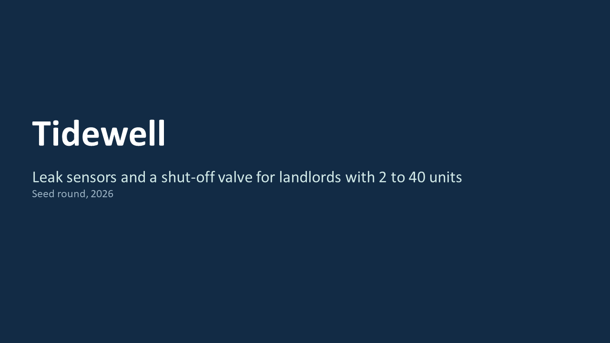
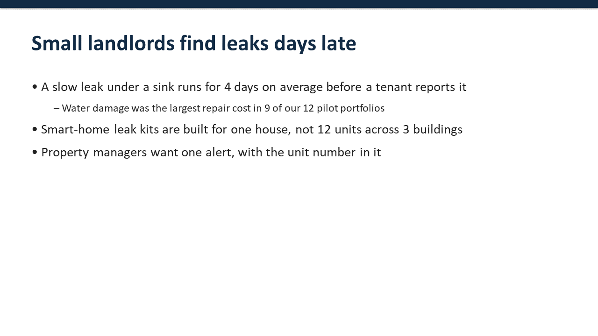
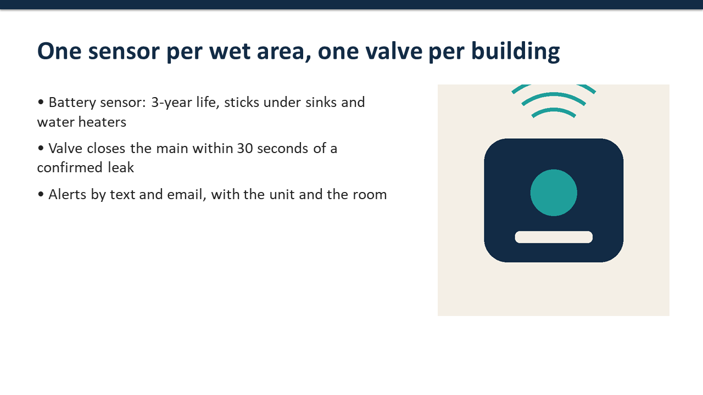
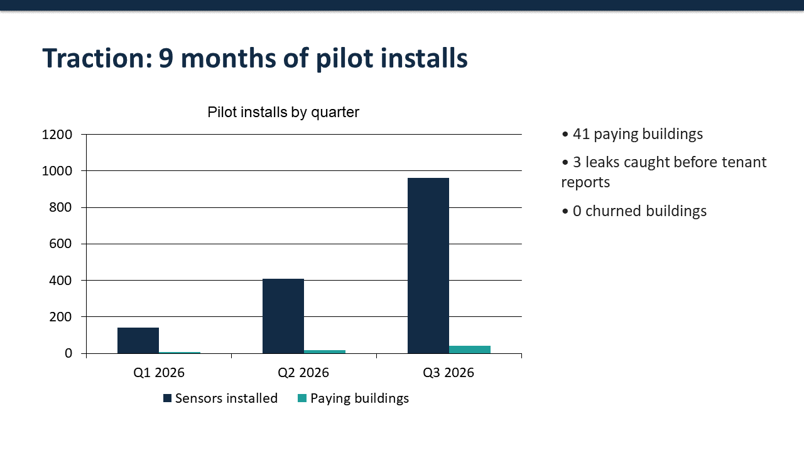
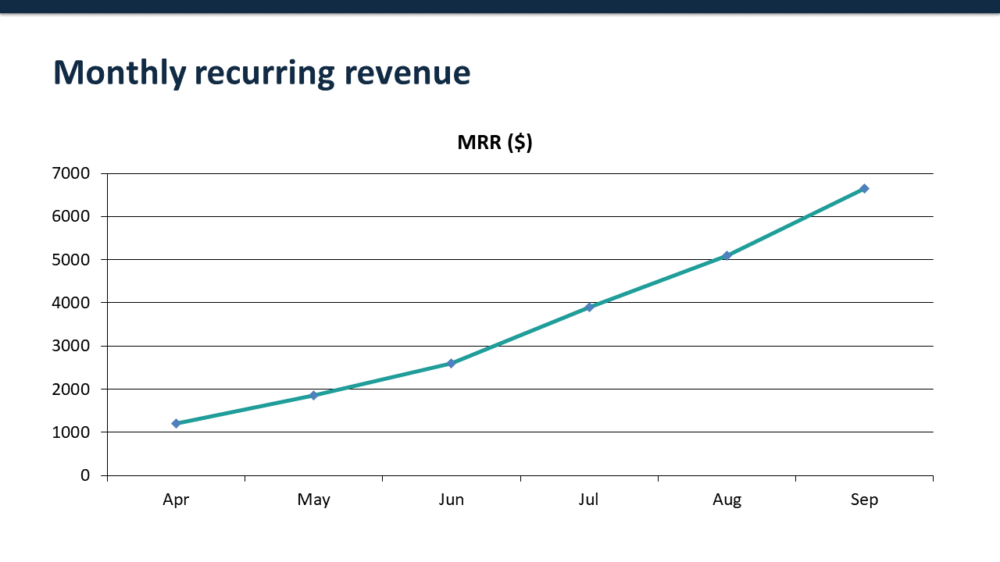
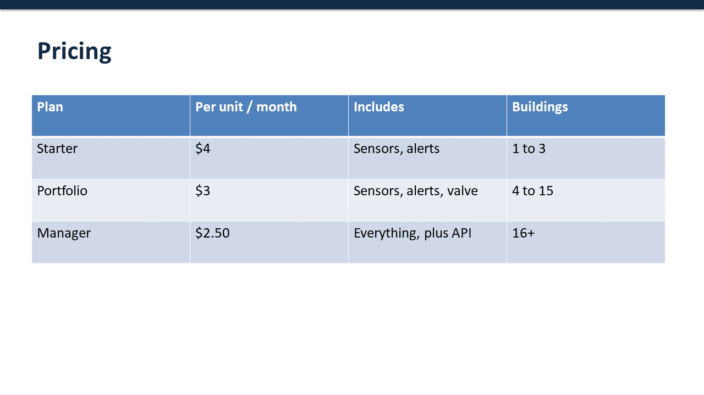
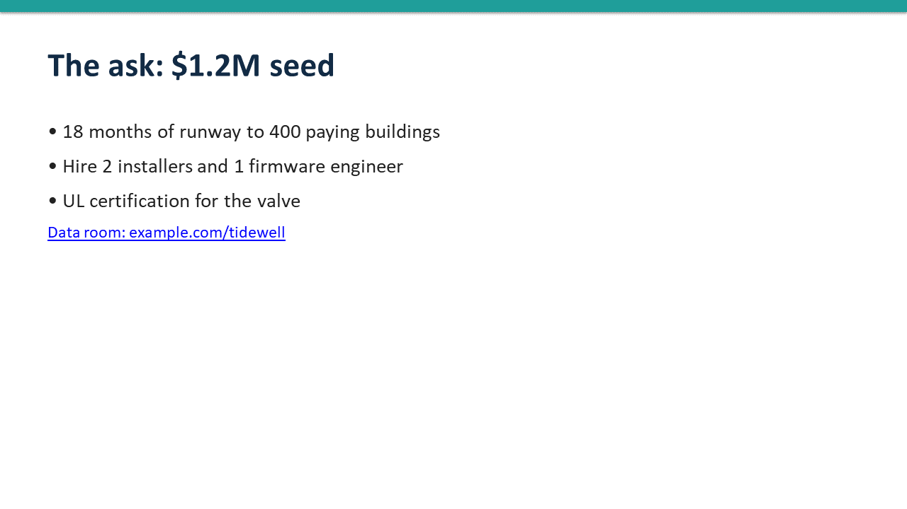
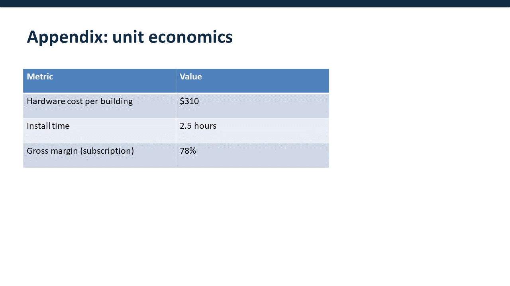

# Tidewell seed deck

Source: `pitch-deck.pptx` (pptx, 13.33 x 7.5 in). Slide images: powerpoint. 9 slides, 1 hidden, 6 with notes, 2 charts, 2 tables.

<!-- generated by amagi-deck 0.1.0 -->

## Outline

1. Tidewell
2. Small landlords find leaks days late
3. One sensor per wet area, one valve per building
4. Traction: 9 months of pilot installs
5. Monthly recurring revenue
6. Pricing
7. Team
8. The ask: $1.2M seed
9. Appendix: unit economics (hidden)

## Slide 1: Tidewell

- Leak sensors and a shut-off valve for landlords with 2 to 40 units
- Seed round, 2026

**Speaker notes**

> Open with the burst pipe story: one unit, one weekend, $12,400 in repairs.
> Keep this slide up for under 20 seconds.

## Slide 2: Small landlords find leaks days late

- A slow leak under a sink runs for 4 days on average before a tenant reports it
  - Water damage was the largest repair cost in 9 of our 12 pilot portfolios
- Smart-home leak kits are built for one house, not 12 units across 3 buildings
- Property managers want one alert, with the unit number in it

**Speaker notes**

> The 4-day figure is from our 31 pilot interviews, not a market study. Say so if asked.

## Slide 3: One sensor per wet area, one valve per building

- Battery sensor: 3-year life, sticks under sinks and water heaters
- Valve closes the main within 30 seconds of a confirmed leak
- Alerts by text and email, with the unit and the room

**Pictures**

- Sensor photo: "Tidewell sensor: a navy puck with a teal status light"

## Slide 4: Traction: 9 months of pilot installs

- 41 paying buildings
- 3 leaks caught before tenant reports
- 0 churned buildings

**Chart: Pilot installs by quarter** (column (clustered))

| Category | Sensors installed | Paying buildings |
|---|---|---|
| Q1 2026 | 140 | 6 |
| Q2 2026 | 410 | 19 |
| Q3 2026 | 960 | 41 |

**Speaker notes**

> Q3 is through September 30 only.
> The 3 caught leaks are the strongest proof point: tell the Elm Street story.

## Slide 5: Monthly recurring revenue

**Chart** (line)

| Category | MRR ($) |
|---|---|
| Apr | 1200 |
| May | 1850 |
| Jun | 2600 |
| Jul | 3900 |
| Aug | 5100 |
| Sep | 6650 |

## Slide 6: Pricing

**Table**

| Plan | Per unit / month | Includes | Buildings |
|---|---|---|---|
| Starter | $4 | Sensors, alerts | 1 to 3 |
| Portfolio | $3 | Sensors, alerts, valve | 4 to 15 |
| Manager | $2.50 | Everything, plus API | 16+ |

**Speaker notes**

> Hardware is sold at cost. The margin is in the monthly fee.

## Slide 7: Team

- Dana Okafor
- CEO. 8 years running a 60-unit portfolio
- Luis Ferreira
- CTO. Built firmware for a smart-meter maker
- Priya Raman
- Ops. Led installs for a regional plumbing firm

## Slide 8: The ask: $1.2M seed

- 18 months of runway to 400 paying buildings
- Hire 2 installers and 1 firmware engineer
- UL certification for the valve
- Data room: example.com/tidewell

**Links**

- https://example.com/tidewell

**Speaker notes**

> Stop talking after the number. Let them ask the first question.

## Slide 9: Appendix: unit economics (hidden)

**Table**

| Metric | Value |
|---|---|
| Hardware cost per building | $310 |
| Install time | 2.5 hours |
| Gross margin (subscription) | 78% |

**Speaker notes**

> Hidden. Show only if someone asks about margins.
